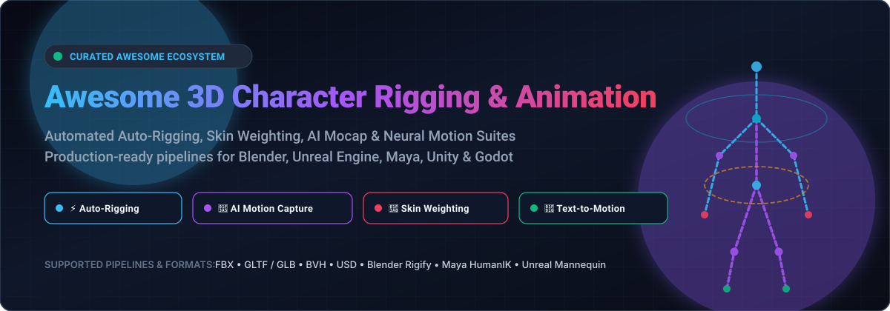

  

# 🦴 Awesome 3D Character Rigging & Animation 🎬

**A curated, production-tested showcase of SaaS platforms, AI models, and open-source tools for automated 3D character rigging, skin weighting, markerless motion capture (mocap), and skeletal animation.**

*Updated regularly for technical artists, indie game developers, VFX animators, and AI graphics researchers.*

---

## 📌 Table of Contents

- [🌐 Sector Overview & Market Dynamics](#-sector-overview--market-dynamics)
- [☁️ SaaS & Hosted Rigging/Animation Platforms](#️-saas--hosted-rigginganimation-platforms)
- [🛠️ Open-Source GitHub Projects](#️-open-source-github-projects)
- [💖 Support & Sponsorship](#-support--sponsorship)
- [🤝 How to Contribute](#-how-to-contribute)
- [📈 Star History](#-star-history)
- [📜 Disclaimer & Licensing](#-disclaimer--licensing)

---

## 🌐 Sector Overview & Market Dynamics

The global **3D animation software and motion capture market** is valued at approximately **$18.5B–$28B+** (with the dedicated 3D character tooling and mocap niche growing at a rapid **11%–15% CAGR** through 2026 and beyond). 

The market dynamics reflect a **moderately fragmented, bifurcated ecosystem**: while core foundation DCC pipelines remain dominated by mega-cap market leaders (Autodesk and Adobe), the specialized layers of **automated neural auto-rigging, AI computer-vision mocap, and diffusion-based text-to-motion** are highly fragmented with competitive VC-backed startups and nimble open-source research labs rapidly democratizing markerless character workflows.

---

## ☁️ SaaS & Hosted Rigging/Animation Platforms

> [!NOTE]
> All pricing figures reflect baseline entry pricing and publicly documented free allowances. Providers are ordered in descending order of parent company size (valuation / enterprise market scale).

| SaaS Platform | Company Scale (Valuation / Revenue) | Starting Price (Paid Tier) | Free Tier Limits / Free Trial Policy | Key Capabilities & Ecosystem |
| :--- | :--- | :--- | :--- | :--- |
| **[Adobe Mixamo](https://www.mixamo.com/)** | **~$69B+ EV / ~$26B Rev** (Adobe, Inc.) | **$0.00 / mo** (Free with Adobe ID) | **100% Free Forever** (Unlimited bipedal humanoid auto-rigs & mocap downloads; no commercial royalties; max 1 active cloud model slot) | Automated cloud skeleton placement, skinning, and library of thousands of downloadable FBX/DAE mocap animations. |
| **[Wonder Dynamics (Autodesk Flow Studio)](https://wonderdynamics.com)** | **~$53B–$55B Market Cap / ~$7.5B Rev** (Autodesk) | **$10.00 / mo** (*Lite Plan*) | **300 credits/mo free forever** (Roughly 15s live-action composition or 30s mocap; 720p max export; 1 GB cloud storage; 3 custom characters) | Cloud AI VFX tool that automatically extracts actor performance from video, tracks camera moves, and replaces actors with rigged 3D CG characters. |
| **[Rokoko Studio](https://rokoko.com)** | **~$80M Valuation / ~$12M–$17M Rev** (Rokoko Care ApS) | **$10.00 / mo** (*Basic Plan*, billed annually) | **Starter Plan: $0 free forever** (Unlimited hardware recording; 30s/mo AI Vision mocap; 5 text-to-motion imports/mo; FBX exports; 1-mo cloud asset storage; 14-day Plus trial available) | Markerless video mocap and motion tracking software suite compatible with smart suits, gloves, webcam tracking, and DCC retargeting. |
| **[Kinetix](https://kinetix.tech)** | **~$50M–$100M Valuation / ~$11.6M Funded** (Kinetix SAS) | **$29.00 / mo** (*Starter Tier*) | **Free Forever Tier** (Up to 3 free video animation generations/mo; 2 GB cloud storage; non-commercial community license) | Cloud AI platform & SDK to extract 3D emotes and character animations from video feeds for games, virtual worlds, and social metaverses. |
| **[Reallusion ActorCore](https://reallusion.com)** | **Private / Multi-Million Studio Revenue** (Reallusion Inc.) | **$29.00 / mo** (*Motion Subscription*, 20 downloads/mo) or ~$1.50–$12/motion | **AccuRIG app: 100% Free Forever** (Unlimited commercial auto-rigging and FBX/USD mesh exports without watermarks; includes starter sample mocap pack) | Desktop auto-rigging application (AccuRIG) and cloud motion asset ecosystem calibrated for Unreal Engine, Unity, Blender, and Maya. |
| **[Cascadeur](https://cascadeur.com)** | **Private / Multi-Million Game & Tech Group** (Nekki Ltd) | **$8.00 / mo** (*Indie Plan*, billed annually) or $19/mo monthly | **Free Forever Tier** (Full rigging, AI AutoPosing, physics trajectory, and secondary motion features; strictly non-commercial; exports limited to proprietary `.casc` format) | Physics-assisted 3D keyframe animation and auto-rigging tool with auto-inbetweening, center-of-mass constraints, and physics correction. |
| **[Anything World (AnyWorld)](https://anything.world)** | **Private / ~$7.5M+ Seed & Venture Funding** (Everything Universe) | **$30.00 / mo** (*Nano Plan*, 100 credits/mo) | **Individual Plan: $0 free forever** (15 credits/mo; includes auto-rigging and animation preview; limited to 1 model download/mo; personal/educational use) | Generative 3D AI and automated rigging pipeline transforming static meshes into articulated, animated characters with runtime Unity/Unreal SDKs. |
| **[Plask](https://plask.ai)** | **Private / ~$2.66M Funded (~$1.4M ARR)** (Plask Inc.) | **$18.00 / mo** (*Standard Plan*, billed annually) | **Freemium: $0 free forever** (15 seconds AI mocap processing per day; 1 GB cloud storage; personal non-commercial use; exports FBX, GLB, BVH) | Browser-based AI motion capture editor for extracting full-body and hand keyframes directly from video clips with retargeting tools. |
| **[DeepMotion](https://deepmotion.com)** | **Private / ~$8.7M Funded (~$1M+ ARR)** (DeepMotion Inc.) | **$9.00 / mo** (*Starter Plan*, billed annually) or $15/mo monthly | **Freemium: $0 free forever** (30–60 credits/mo, ~60s animation total; max 20s per clip; 100 MB upload limit; 1080p 30fps export; personal non-commercial use) | AI-powered markerless motion capture generating physics-simulated full-body, hand, and facial 3D character animations from standard video. |
| **[Move.ai](https://move.ai)** | **Acquired by Oxford Metrics / Vicon (~£1.1M Rev)** | **$15.00 / mo** (*Personal Plan*) or $18/mo base tier | **Free Trial Account: 30 credits one-time** (Processes up to 30s video clip; non-commercial research/evaluation license; no recurring replenishment without paid plan) | Single-camera iPhone (Move One) and multi-camera markerless AI motion capture platform outputting high-fidelity skeletal animations. |

---

## 🛠️ Open-Source GitHub Projects

> [!TIP]
> The table below showcases the strongest open-source auto-riggers, AI mocap suites, and generative text-to-motion frameworks. Projects are sorted in **descending order by GitHub star count**. Star badges link directly to each repository's stargazers community.

| Project / Repository | GitHub Stars | Primary Focus / Architecture | License | Description |
| :--- | :--- | :--- | :--- | :--- |
| **[Godot Engine](https://github.com/godotengine/godot)** |  | Runtime Rigging & IK System | `MIT` | Multi-platform 2D/3D game engine featuring runtime `Skeleton3D`, inverse kinematics (`SkeletonIK3D`), animation blending trees, and retargeting modifiers. |
| **[Blender](https://github.com/blender/blender)** |  | DCC Rigging & Animation Suite | `GPL-2.0+` | Complete open-source 3D creation suite featuring the **Rigify** modular character rigging system, automatic vertex heat-map weighting, Bendy Bones, and NLA. |
| **[FreeMoCap](https://github.com/FreeMoCap/freemocap)** |  | Markerless Motion Capture | `AGPL-3.0` | Hardware-agnostic multi-camera markerless motion capture platform capturing 3D body, hand, and facial kinematics into clean character rigs. |
| **[Open 3D Engine (O3DE)](https://github.com/o3de/o3de)** |  | Enterprise Skeletal Animation | `Apache-2.0` | AAA game engine featuring **EMotion FX**, a comprehensive character animation system with state machines, ragdoll physics, and secondary kinematics. |
| **[Kimodo](https://github.com/nv-tlabs/kimodo)** |  | Kinematic Motion Diffusion | Research | NVIDIA research implementing a kinematic motion diffusion model for high-fidelity human and humanoid motion synthesis. |
| **[Human Motion Diffusion Model (MDM)](https://github.com/GuyTevet/motion-diffusion-model)** |  | Text-to-Motion Diffusion | `MIT` | Pioneer diffusion-based generative model predicting realistic 3D human skeletal motion sequences from natural language descriptions. |
| **[Mesh2Motion](https://github.com/scottpetrovic/mesh2motion-app)** |  | Browser Mixamo Alternative | `GPL-3.0` | Web and desktop auto-rigging application with joint snapping, automated skin binding, and 40+ CC0 animations for bipeds, quadrupeds, and birds. |
| **[HY-Motion 1.0 (Tencent Hunyuan)](https://github.com/Tencent-Hunyuan/HY-Motion-1.0)** |  | Billion-Scale Text-to-Motion | `Apache-2.0` | Tencent Hunyuan's billion-parameter Diffusion Transformer (DiT) flow-matching model generating fluid 3D character skeletal animations from text prompts. |
| **[UniRig (VAST-AI)](https://github.com/VAST-AI-Research/UniRig)** |  | Unified Autoregressive Auto-Rig | `Apache-2.0` | SIGGRAPH 2025 auto-rigging model predicting skeleton joint hierarchies and per-vertex skinning weights for arbitrary meshes via transformers. |
| **[OpenSeeFace](https://github.com/emilianavt/OpenSeeFace)** |  | Real-time Facial Tracking | `BSD-2-Clause` | Real-time facial landmark tracking and gaze estimation sending FACS blendshapes to Unity, Blender, and Unreal character rigs over UDP/VMC. |
| **[MakeHuman](https://github.com/makehumancommunity/makehuman)** |  | Parametric Character Rigger | `AGPL-3.0` | 3D humanoid generator creating rigged meshes with pre-bound Game Engine, Mixamo, and Rigify armatures ready for immediate production export. |
| **[RigNet](https://github.com/Zhan-Xu/RigNet)** |  | Neural Skeleton & Skinning | Academic | End-to-end deep learning framework predicting articulated skeletons and volumetric skinning weights from 3D surface mesh topology. |
| **[AssetFurnace / Image-to-3D Lab](https://github.com/Bingeljell/image-to-3dlab)** |  | Image-to-Rigged-Character Pipeline | `Apache-2.0` | Local pipeline transforming 2D pictures/prompts into textured, automatically rigged, and animated game characters with 20+ preset moves. |
| **[MotionDirector](https://github.com/showlab/MotionDirector)** |  | Motion Customization Diffusion | `Apache-2.0` | ECCV 2024 oral framework decoupling motion from appearance to customize dynamic video and 3D character motion paths. |
| **[MotionDiffuse](https://github.com/MotrixLab/MotionDiffuse)** |  | Text-Driven Motion Generation | `Apache-2.0` | Text-driven human motion diffusion model supporting anatomical kinematic conditioning and multi-action composition. |
| **[Motion Latent Diffusion (MLD)](https://github.com/ChenFengYe/motion-latent-diffusion)** |  | Latent Motion Diffusion | `Apache-2.0` | CVPR 2023 latent space motion diffusion architecture delivering high-fidelity real-time text-to-motion generation. |
| **[Text-to-Motion](https://github.com/EricGuo5513/text-to-motion)** |  | Text-Driven Kinematics | `MIT` | CVPR 2022 framework for generating diverse and natural 3D human skeletal motions from open-domain text instructions. |
| **[MPFB2](https://github.com/makehumancommunity/mpfb2)** |  | Blender Parametric Human Rigger | `GPL-3.0` | MakeHuman Plugin for Blender (MPFB) bringing in-viewport parametric humanoid generation, Rigify rigging, and procedural skinning. |
| **[Spine Animation AI](https://github.com/GenielabsOpenSource/spine-animation-ai)** |  | AI 2D/3D Skeletal Rigging | `MIT` | AI-assisted rigging skill for skeletal character animation, bone hierarchy generation, weight painting, and procedural motion preview. |
| **[SkinTokens](https://github.com/VAST-AI-Research/SkinTokens)** |  | Tokenized Skinning Weights | `Apache-2.0` | Tokenized representation of skinning weights enabling efficient autoregressive skin weight prediction for articulated 3D meshes. |
| **[Fairmotion](https://github.com/facebookresearch/fairmotion)** |  | Motion Processing Framework | `MIT` | Meta Research library for easy loading, processing, retargeting, and visualizing motion capture sequences across BVH, ASF/AMC, and raw formats. |
| **[FACSvatar](https://github.com/NumesSanguis/FACSvatar)** |  | FACS Facial Animation Pipeline | `GPL-3.0` | Real-time modular facial animation pipeline connecting OpenCV/OpenFace tracking to 3D character blendshape rigs in Blender and Unity. |
| **[Puppeteer (Seed3D)](https://github.com/Seed3D/Puppeteer)** |  | Video-Guided Differentiable Rigging | `Apache-2.0` | NeurIPS 2025 neural rigging framework generating skeletons and skinning weights driven by video reference with FBX export. |
| **[mGear](https://github.com/mgear-dev/mgear4)** |  | Production Maya Rigging Framework | `MIT` | Industrial-strength modular rigging framework for Autodesk Maya featuring Shifter modular biped/quadruped rigs, Synoptic pickers, and solvers. |
| **[GameRig](https://github.com/Arminando/GameRig)** |  | Blender to Game Engine Rigger | `GPL-3.0` | Blender auto-rigging add-on built on Rigify that automatically generates clean, deformation-only skeleton hierarchies optimized for Unity and Unreal. |
| **[skin-tokens.cpp](https://github.com/localai-org/skin-tokens.cpp)** |  | Lightweight C++ Skinning Inference | `MIT` | High-performance C++/GGML implementation of SkinTokens for lightweight CPU/GPU auto-rigging inference on resource-constrained devices. |
| **[dpAutoRigSystem](https://github.com/nilouco/dpAutoRigSystem)** |  | Maya Modular Auto-Rigger | `MIT` | Python-based auto-rigging system for Autodesk Maya offering biped, quadruped, vehicle, and modular limb rigs with integrated IK/FK switching. |
| **[adamscript/Auto-Rigger](https://github.com/adamscript/Auto-Rigger)** |  | Maya Guide-Based Auto-Rigger | `MIT` | Maya auto-rigging toolkit creating humanoid IK/FK controls, reverse-foot roll setups, and custom viewport controller pickers from locator guides. |
| **[vid2anim](https://github.com/mehulcode12/vid2anim)** |  | AI Video Mocap & Retargeter | `MIT` | AI-driven motion capture studio with a Blender add-on providing universal character retargeting for Mixamo, VRM, Rigify, and Unreal Mannequins. |
| **[auto-rig-web](https://github.com/nff747/auto-rig-web)** |  | Client-Side WebGL Auto-Rigger | `MIT` | Zero-install in-browser 3D mesh auto-rigging app running ONNX neural models directly inside Web Workers for instant GLB character binding. |
| **[Roboticela/Animator](https://github.com/Roboticela/Animator)** |  | Tauri/Rust 3D Keyframe Studio | `AGPL-3.0` | Cross-platform desktop 3D animation studio built with Tauri, Rust, and Three.js for bone inspection, clip authoring, and GLB animation export. |
| **[Poseforge](https://github.com/wolfgangjblack/poseforge)** |  | Interactive Sketch Posing Tool | `MIT` | Local-first browser studio for rigging 3D models and posing skeletons via 3D gizmos or intuitive 2D stick-figure sketches with GLB export. |
| **[AutoTPose](https://github.com/4onstudios/AutoTPose)** |  | Humanoid T-Pose Standardizer | `GPL-3.0` | Blender add-on to automatically rig humanoid GLB/FBX meshes and normalize diverse character poses into clean, animation-ready T-poses. |
| **[autorig-workbench](https://github.com/sambena/autorig-workbench)** |  | Headless Blender Batch Rigger | `GPL-3.0` | Automated rigging pipeline combining headless Blender execution, JSON rig definitions, automated topology audits, and a 3D web viewer. |

---

## 💖 Support & Sponsorship

If this curated repository saved you hours of scouring forums or helped streamline your 3D animation and rigging pipeline, please consider supporting the project:

- ⭐ **Star this repository** to help others discover these tools!
- 🍴 **Fork and contribute** by adding newly released open-source models and platforms.
- 📣 **Share with your network** of game developers, technical artists, and animators.
- ☕ **Buy me a coffee / Sponsor on GitHub:** [Sponsor @ishandutta2007](https://github.com/sponsors/ishandutta2007)

Your support keeps this ecosystem up-to-date with the newest breakthroughs in computer graphics and generative 3D AI!

---

## 🤝 How to Contribute

We welcome contributions from 3D animators, technical artists, game developers, and researchers!

1. **Fork the repository** to your GitHub profile.
2. **Add or update an entry** in `README.md` following our structured tabular format.
3. Make sure to include:
   - Tool or repo name and canonical link
   - Specific pricing tiers and explicit free limits (for SaaS)
   - Real star count badge and direct repository link (for Open Source)
   - Clear, concise technical description
4. **Submit a Pull Request** with a descriptive summary of what you added or improved.

---

##  Star History

---

## 📜 Disclaimer & Licensing

- This repository is a community-curated directory compiled for educational, research, and production reference.
- Product trademarks, logos, and brand names belong to their respective corporate owners.
- Deep-learning auto-rigging models (e.g., UniRig, Puppeteer, SkinTokens) typically require CUDA-compatible hardware and PyTorch environments.
- Always verify licensing conditions (`MIT`, `Apache-2.0`, `GPL-3.0`, or non-commercial research restrictions) before bundling rigged 3D models into commercial games or media.

---

**Built with ❤️ for 3D character artists, technical riggers, game developers, and AI researchers worldwide.**

